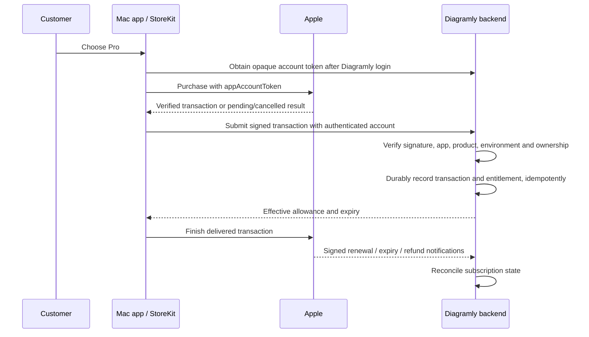

# Apple payments and Diagramly entitlements

Decision date: 2026-11-11. Desktop payment provider: Apple In-App Purchase. Implementation status: not connected. No products, purchases, keys, agreements or existing subscriptions were changed.

## Boundary

Use native StoreKit 2 in the macOS shell for product presentation and purchases. Read localized price and duration from StoreKit rather than hard-coding US amounts in the interface. The webview can request a bounded native action; it cannot grant paid access. Reject purchase commands from untrusted origins and arbitrary diagram HTML. Do not expose native purchasing or tokens to diagram iframes.

The Diagramly backend verifies Apple-signed transaction data, checks the app/product/environment, and maps the result into its own entitlement ledger. Apple payment does not sign the user into Diagramly. Diagramly login does not prove an Apple subscription. External MCP clients use their own AI accounts and are independent of both.

Apple documents [appAccountToken](https://developer.apple.com/documentation/storekit/transaction/appaccounttoken) as a UUID associating a transaction with the developer's user. Use a server-issued random UUID, not an email address or mutable local account ID. Its presence alone is not authorization: verify the signed transaction and ownership. Keep account-linking mappings and App Store API credentials on the backend; do not put private signing keys in the Mac bundle.

## Proposed implementation units

1. Native adapter: product fetch, purchase, transaction listener, current entitlements, explicit restore and manage-subscription action. StoreKit Testing first; real sandbox next.
2. Authenticated backend transaction endpoint with an allowlist of shipping products and separate sandbox/production environments. Use Apple's server library/API for signature and status verification. Preserve original transaction ID, account binding and event provenance with uniqueness constraints.
3. Durable notification inbox for App Store Server Notifications V2. Verify outer and nested signed data, deduplicate, reconcile delayed/out-of-order updates, and retain retry state. Do not grant credit twice for repeated transactions or notifications.
4. Read-only scoped desktop entitlement endpoint, building on existing issues #1 and #2. Current website protected procedures require a session as well as a user, so a device token is not sufficient today. Do not weaken every website guard.
5. Monthly usage ledger for annual and monthly products; subscription duration is not the quota reset schedule. Define reset boundaries and credit expiration before selling. Do not grant a second allowance for an existing web subscription or an account switch.

Use [App Store Server API](https://developer.apple.com/documentation/appstoreserverapi) and [Server Notifications](https://developer.apple.com/documentation/appstoreservernotifications) as implementation references. Endpoint names above are proposed contracts, not existing API claims.

## Acceptance cases

| Case                                                   | Required result                                                                                                         |
| ------------------------------------------------------ | ----------------------------------------------------------------------------------------------------------------------- |
| New purchase succeeds                                  | One verified entitlement; paid operation succeeds; transaction delivered and finished                                   |
| Cancelled purchase                                     | No charge-success message or entitlement                                                                                |
| Pending approval                                       | Explicit pending state; no premature paid access                                                                        |
| Backend temporarily unavailable after purchase         | Recoverable processing state; transaction recovered after restart without another purchase                              |
| Reinstall / second Mac / Restore Purchases             | Recover access from Apple and reconcile Diagramly binding; no duplicate credits                                         |
| Different Diagramly account                            | Explain existing binding; do not silently transfer subscription or local documents                                      |
| Existing website subscriber                            | Show effective access and billing source; prevent accidental duplicate purchase; no automatic cancellation or migration |
| Renewals delivered twice or out of order               | Stable, idempotent effective entitlement and allowance                                                                  |
| User disables renewal                                  | Access continues to the verified expiry, not immediately revoked                                                        |
| Refund/revocation/expiration                           | Cloud entitlement follows verified state; local documents remain available                                              |
| Grace period / billing retry                           | Follow verified Apple status and configured policy; no assumed infinite access                                          |
| Offline / expired device token                         | Local work still opens; accurately distinguish cached access, unavailable verification and expired cloud login          |
| Forged transaction / wrong product / wrong environment | Rejected without granting entitlement or leaking identifiers                                                            |
| Untrusted iframe invokes bridge                        | Denied; no purchase sheet or token disclosure                                                                           |

Apple requires a [restore mechanism](https://developer.apple.com/in-app-purchase/) for restorable purchases. Restore must be visible in the purchase/settings experience and must not require paying again. Include the plan name, renewal period, full billed price, privacy and terms links before purchase; review exact presentation against current [subscription guidance](https://developer.apple.com/app-store/subscriptions/).

## App Store release constraints

The Mac App Store build must use Apple-delivered updates. Do not include a working upstream/self-update path in this release profile. The present debug/bundled-server guard already disables upstream updates; that is not a production App Store configuration. Apple's [Mac requirements in 2.4.5](https://developer.apple.com/app-store/review/guidelines/) also make sandboxing, self-contained packaging and helper-process termination important acceptance gates. Explain the bundled local server and MCP listener in review notes. Verify security boundaries for generated HTML and all code-execution/download features; sandbox success alone is not App Review approval.

The account holder must complete any required paid-app agreements, banking/tax setup and product configuration in App Store Connect. Check existing state first. A local Developer ID Application certificate is not proof that Mac App Store signing, provisioning or commerce agreements are ready.

Use Apple subscription-management and refund routes for Apple purchases. Existing website refund wording is a policy reference to review, not a promise that a web checkout refund mechanism can refund an Apple transaction.
